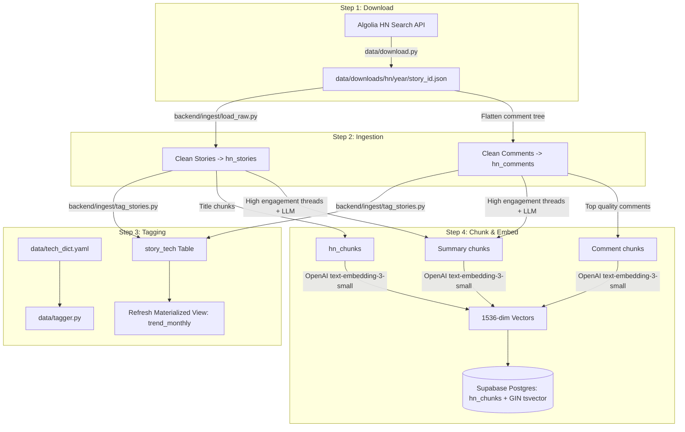

# Phase 4: Ingestion, Tagging & Embedding Pipeline Plan (`phase4-todo.md`)

This document is the master specification and implementation plan for **Phase 4: Ingestion, Tagging & Embedding Pipeline** of TechPilot. It details the complete flow from downloading raw Hacker News threads to parsing, entity tagging, LLM summarization, vector embedding, and materialized view refreshing.

---

## 1. Pipeline Overview & Architecture

The ingestion pipeline transforms raw external data from the Algolia Hacker News API into structured relational models and hybrid search indexes in Supabase Postgres.



---

## 2. End-to-End Pipeline Steps

### Step 1: Raw Data Download (`data/download.py`)

#### What Needs to Be Done
1. **Targeted Technology Crawling**:
   - Utilize existing `data/download.py` to query Algolia HN API (`https://hn.algolia.com/api/v1/items/{id}`).
   - Support downloading via keywords (`-q flutter -q react-native -q bun`), dictionary categories (`--from-dict --categories mobile,runtime`), or historical date ranges (`--since 2025-01-01 --min-points 50`).
2. **Local Storage & Idempotency**:
   - Save payloads under `data/downloads/hn/<year>/<story_id>.json`.
   - Include timestamp `fetched_at` (ISO 8601 UTC) inside each JSON payload for freshness tracking.
   - Skip files already present on disk unless `--refresh-days N` is explicitly specified.
3. **Execution Command**:
   ```bash
   # Development smoke test (5 threads per keyword)
   uv run data/download.py -q bun -q node -q zustand --since 2025 --min-points 20 --limit 5

   # Production corpus sync
   uv run data/download.py --from-dict --since 2025 --min-points 50
   ```

#### Expected Result
- Directory `data/downloads/hn/<year>/` populated with clean JSON files named by story ID (e.g. `data/downloads/hn/2024/39201928.json`).
- Each file contains complete thread metadata: story title, author, points, timestamp, URL, and full recursive `children` comment tree.

---

### Step 2: Raw Ingestion & Sanitization (`backend/ingest/load_raw.py`)

#### What Needs to Be Done
1. **Story Parsing & Text Sanitization**:
   - Parse top-level story fields into `HNStory` schema: `id`, `title`, `url`, `author`, `points`, `num_comments`, `created_at`, `kind` (`story`, `ask_hn`, `show_hn`).
   - Clean HTML tags, unescape HTML entities, and remove zero-width spaces while preserving code references.
2. **Recursive Comment Tree Flattening**:
   - Recursively traverse the `children` array of each story.
   - Compute tree metrics:
     - `depth`: 0 for root replies to story, 1 for replies to replies, etc.
     - `parent_id`: Parent comment ID or null if direct story reply.
     - `n_children`: Recursive count of all descendants under this comment.
3. **Comment Quality Score Calculation**:
   - Infer `quality_score` (float between 0.0 and 1.0) based on signals:
     - **Text Length**: Substantial answers (100–1000 characters) score higher; one-liners score lower.
     - **Code & Specificity**: Presence of formatted code (`<pre>`, `<code>`, backticks) or version references adds bonus weight.
     - **Discussion Traction**: Higher `n_children` indicates community engagement and debate relevance.
     - **Depth Penalty**: Extreme depth (>4) slightly dampens score to prioritize direct answers.
4. **Database Upsert**:
   - Batch insert stories into `hn_stories` with `ON CONFLICT (id) DO UPDATE`.
   - Batch insert flattened comments into `hn_comments` with `ON CONFLICT (id) DO UPDATE`.
   - Connect using SQLAlchemy session / psycopg engine configured in `app.config.settings.DATABASE_URL`.

#### Expected Result
- Tables `hn_stories` and `hn_comments` populated with cleaned relational rows.
- No HTML artifacts in text fields. Every comment has correct `story_id`, `parent_id`, `depth`, `n_children`, and computed `quality_score`.

---

### Step 3: Entity Tagging & Trend Aggregation (`backend/ingest/tag_stories.py`)

#### What Needs to Be Done
1. **Integrate `Tagger` and `tech_dict.yaml`**:
   - Load `data/tech_dict.yaml` using `Tagger` from `data/tagger.py`.
   - Validate canonical aliases, ambiguous terms requiring context (e.g., "Go", "Swift", "Bloc"), and one-level `implies` relationships.
2. **Tag Stories & Populate `story_tech`**:
   - Run `tagger.tag_story(title, text, url)` across all ingested `hn_stories`.
   - Extract:
     - `tech`: Canonical technology identifier (e.g., `bun`, `react`, `zustand`).
     - `category`: Category from dictionary (e.g., `runtime`, `frontend-framework`, `state-mgmt`).
     - `in_title`: Boolean indicating if match appeared in story title.
     - `via`: Matching rule (`direct`, `ambiguous`, or `implied`).
   - Upsert records into `story_tech` (`story_id`, `tech`, `category`, `in_title`, `via`) with `ON CONFLICT (story_id, tech) DO UPDATE`.
3. **Monthly Totals Sync (`hn_totals_monthly`)**:
   - Ensure `hn_totals_monthly` table has rows for each month represented in `hn_stories` (for normalizing share percentages).
4. **Refresh Materialized View**:
   - Execute SQL command:
     ```sql
     REFRESH MATERIALIZED VIEW CONCURRENTLY trend_monthly;
     ```
   - Verifies the unique index `uq_trend_monthly_tech_category_month` on `(tech, category, month)`.

#### Expected Result
- `story_tech` table populated with accurate technology tags for every story without ambiguous noise.
- `trend_monthly` materialized view refreshed, providing instant SQL analytics (`story_count`, `total_points`, `total_comments`, `pct_of_monthly_stories`) grouped by `(tech, category, month)`.

---

### Step 4: Chunking, LLM Summarization & Embedding (`backend/ingest/chunk_and_embed.py`)

#### What Needs to Be Done
1. **Three-Tier Chunk Generation Strategy**:
   - **Tier A: Title Chunks (`chunk_type: 'title'`)**:
     - Created for every tagged story.
     - Format:
       ```text
       Story Title: {title}
       URL: {url}
       Category: {category} | Tags: {tech_tags}
       Points: {points} | Comments: {num_comments} | Date: {created_at}
       {body_excerpt if present}
       ```
   - **Tier B: LLM Thread Summaries (`chunk_type: 'summary'`)**:
     - For notable threads (`num_comments >= 50` or `points >= 50`).
     - Invoke OpenAI `gpt-4o-mini` with a focused prompt to generate a 150–250 word synthesis:
       - What announcement or topic triggered the discussion.
       - What the community consensus or split was.
       - Key arguments, benefits, drawbacks, and developer migration reasons cited.
     - Format:
       ```text
       Thread Summary: {story_title} (HN ID: {story_id})
       Discussed Technologies: {tech_tags}
       Key Community Perspectives:
       {llm_summary}
       ```
   - **Tier C: High-Quality Comment Chunks (`chunk_type: 'comment'`)**:
     - Extracted from top-scoring comments (`quality_score >= 0.65` or top 3 per notable thread).
     - Formatted with parent story context for retrieval grounding:
       ```text
       Comment on '{story_title}' by {author} (HN ID: {comment_id}):
       {cleaned_comment_text}
       ```
2. **Batch Vector Embedding**:
   - Batch chunk texts in chunks of 50–100 items.
   - Generate embeddings using OpenAI `text-embedding-3-small` (1536 dimensions) via `AsyncOpenAI(api_key=settings.OPENAI_API_KEY)`.
3. **Database Insertion & GIN Index**:
   - Insert records into `hn_chunks` with `id=uuid4()`, `story_id`, `comment_id`, `chunk_type`, `content`, `embedding`, `quality_score`, `metadata_json`.
   - `metadata_json` stores permalink URL (`https://news.ycombinator.com/item?id=...`), author, points, and matched technologies.
   - Postgres automatically computes the generated `search_vector = to_tsvector('english', content)` column.

#### Expected Result
- Table `hn_chunks` contains high-density, searchable chunks of all three types (`title`, `summary`, `comment`).
- All chunks have non-null 1536-dimensional embeddings and active GIN `search_vector` index entries ready for hybrid retrieval.

---

### Step 5: Unified Pipeline Orchestrator CLI (`backend/ingest/run_pipeline.py`)

#### What Needs to Be Done
Provide a unified CLI entrypoint that coordinates the entire lifecycle with granular step flags and progress reporting:

```bash
# Run entire pipeline from downloads to embeddings:
uv run python -m app.ingest.run_pipeline --all

# Run specific stages:
uv run python -m app.ingest.run_pipeline --load --tag
uv run python -m app.ingest.run_pipeline --chunk --embed --limit 100
uv run python -m app.ingest.run_pipeline --refresh-trends
```

#### Pipeline Steps Inside Orchestrator
1. `step_load_raw()`: Reads `data/downloads/hn/` -> Populates `hn_stories` and `hn_comments`.
2. `step_tag()`: Runs tagger -> Populates `story_tech` -> Refreshes `trend_monthly`.
3. `step_chunk()`: Generates title, summary, and comment chunks.
4. `step_embed()`: Batch embeds via OpenAI -> Saves to `hn_chunks`.

---

## 3. Detailed Component & File Breakdown

```text
backend/app/
├── config.py                         # (Existing) Settings for DB, OpenAI API Key & models
├── database/
│   ├── models/
│   │   └── hn.py                     # (Existing) SQLAlchemy models for HNStory, HNComment, StoryTech, HNChunk
│   └── session.py                    # [NEW] Async / Sync SQLAlchemy session helper for batch ingest scripts
└── ingest/
    ├── __init__.py                   # Package init
    ├── load_raw.py                   # Step 2: Algolia JSON -> hn_stories, hn_comments
    ├── tag_stories.py                # Step 3: Tagger -> story_tech & trend_monthly refresh
    ├── summarizer.py                 # Step 4a: LLM thread summarizer using gpt-4o-mini
    ├── chunk_and_embed.py            # Step 4b: Chunk assembly & OpenAI batch embedding
    └── run_pipeline.py               # Step 5: Unified CLI runner coordinating all steps

data/
├── download.py                       # (Existing) Algolia HN API crawler
├── tagger.py                         # (Existing) Tech keyword and context tagger
└── tech_dict.yaml                    # (Existing) Technology dictionary
```

---

## 4. Verification & Validation Steps

1. **Download Verification**:
   - Run crawler on a test query:
     ```bash
     uv run data/download.py -q bun --limit 3 --since 2025
     ```
   - Verify files exist under `data/downloads/hn/2025/*.json`.

2. **Ingestion Verification**:
   - Run loader:
     ```bash
     uv run python -m app.ingest.run_pipeline --load
     ```
   - Check database counts:
     ```sql
     SELECT COUNT(*) FROM hn_stories;
     SELECT COUNT(*) FROM hn_comments;
     SELECT story_id, COUNT(*) FROM hn_comments GROUP BY story_id LIMIT 5;
     ```

3. **Tagging & Trend Verification**:
   - Run tagging:
     ```bash
     uv run python -m app.ingest.run_pipeline --tag --refresh-trends
     ```
   - Check `story_tech` and materialized view:
     ```sql
     SELECT tech, category, COUNT(*) FROM story_tech GROUP BY tech, category ORDER BY count DESC LIMIT 10;
     SELECT * FROM trend_monthly WHERE tech = 'bun' ORDER BY month DESC;
     ```

4. **Chunking & Hybrid Search Verification**:
   - Run chunk & embed:
     ```bash
     uv run python -m app.ingest.run_pipeline --chunk --embed --limit 20
     ```
   - Verify vector and full-text search:
     ```sql
     -- Verify chunks inserted
     SELECT chunk_type, COUNT(*) FROM hn_chunks GROUP BY chunk_type;

     -- Verify full-text search
     SELECT id, chunk_type, content FROM hn_chunks WHERE search_vector @@ websearch_to_tsquery('english', 'performance');

     -- Verify vector search
     SELECT id, chunk_type, (embedding <=> '[...]'::vector) AS distance
     FROM hn_chunks WHERE embedding IS NOT NULL ORDER BY distance ASC LIMIT 5;
     ```

5. **Code Style & Quality**:
   ```bash
   cd backend && uv run ruff check app/ingest && uv run ruff format --check app/ingest
   ```
